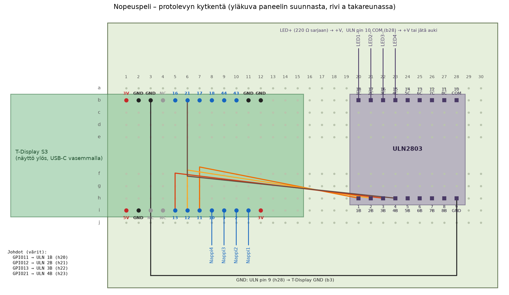

# Kytkentä

Kaavio: [`kytkenta.png`](kytkenta.png) (luodaan skriptillä `kytkenta.py`).

## Protolevy

- Mitat 81 × 55 mm, rivit a–e ja f–j (kuten koekytkentälevyssä; a–e ja f–j ovat omia ryhmiään), keskikanava 7,62 mm.
- Katsotaan paneelin puolelta: **sarake 1 on vasemmalla**, **rivi a on takareunassa**.
- Mitat ja pinnien paikat on luettu STEP-mallista `kotelo/.../electronics_reference_v3_17.step`.
  Sarakkeen n x-koordinaatti: `9,535 − (n−1)·2,54` mm.

## T-Display S3 (sarakkeet 1–12, rivit b ja i)

Näyttö ylöspäin kohti paneelia, ESP32-puoli protolevyä kohti. Sarake 1 on USB-C:n puoleinen pää.

| Sarake | 1 | 2 | 3 | 4 | 5 | 6 | 7 | 8 | 9 | 10 | 11 | 12 |
|---|---|---|---|---|---|---|---|---|---|---|---|---|
| **rivi b** (piikkirivi P1) | 3V | GND | GND | NC | GPIO16 | **GPIO21** | GPIO17 | GPIO18 | GPIO44 | GPIO43 | GND | GND |
| **rivi i** (piikkirivi P2) | **5V** | GND | NC | NC | **GPIO13** | **GPIO12** | **GPIO11** | **GPIO10** | **GPIO3** | **GPIO2** | **GPIO1** | 3V |

Lihavoidut ovat peliin käytetyt.

## ULN2803 (sarakkeet 20–28, rivit b ja h)

DIP-18-numerointi: pinni 1 on h20, pinni 9 on h28, pinni 10 on b28 ja pinni 18 on b20.

| Pinni | Reikä | Nimi | Käyttö |
|---|---|---|---|
| 1 | h20 | 1B | ← GPIO11 |
| 2 | h21 | 2B | ← GPIO12 |
| 3 | h22 | 3B | ← GPIO13 |
| 4 | h23 | 4B | ← GPIO21 |
| 5–8 | h24–h27 | 5B–8B | ei käytössä |
| 9 | h28 | GND | → T-Displayn GND (esim. b3) |
| 10 | b28 | COM | → +V tai auki (LEDeille ei pakollinen) |
| 15 | b23 | 4C | → LED4 katodi |
| 16 | b22 | 3C | → LED3 katodi |
| 17 | b21 | 2C | → LED2 katodi |
| 18 | b20 | 1C | → LED1 katodi |

## Johdotus

| Mistä | Mihin |
|---|---|
| i7 (GPIO11) | h20 (ULN 1B) |
| i6 (GPIO12) | h21 (ULN 2B) |
| i5 (GPIO13) | h22 (ULN 3B) |
| b6 (GPIO21) | h23 (ULN 4B) |
| i11 (GPIO1) | Nappi 1, toinen jalka GND:hen |
| i10 (GPIO2) | Nappi 2, toinen jalka GND:hen |
| i9 (GPIO3) | Nappi 3, toinen jalka GND:hen |
| i8 (GPIO10) | Nappi 4, toinen jalka GND:hen |
| h28 (ULN GND) | b3 (T-Displayn GND) |
| b20–b23 (ULN 1C–4C) | LED1–LED4 katodit |
| +V → 220 Ω → LED-anodi | kunkin LEDin anodi |

Napit ovat active LOW sisäisellä pull-upilla, joten ulkoisia vastuksia ei tarvita.
LEDit syttyvät, kun GPIO on HIGH (ULN johtaa).

## Avoimet kohdat

- **ULN:n pinninumerointi:** DIP-18:ssa pinni 10 on vastapäätä pinniä 9, eli b28. Pinni 16 olisi b22.
  Tarkista moduulin oma numerointi.
- **LEDien +V:** 5V-pinni (i1) toimii vain USB-virralla. Akulla käytettäessä sitä ei syötetä.
  3V3 antaa ULN:n kanssa himmeän valon (~1,4 mA / 220 Ω).
- **Vastuksen paikka:** 220 Ω ei ole tässä kaaviossa protolevyllä. Oletus on, että se on LEDin
  anodipuolella napin/kotelon kaapelissa.
